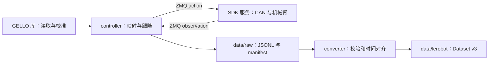

# 架构与数据流

## 边界

controller 是应用入口。它决定使用哪些客户端、何时启动或关闭服务，以及何时开始、保存或丢弃 episode。

| 运行单元 | 环境 | 数据/设备所有权 |
| --- | --- | --- |
| controller + GELLO 基础包 | 根目录 `.venv`，3.11 | GELLO 串口、机器人客户端、应用状态、raw |
| SDK server | SDK 自己的 `.venv`，3.11 | CAN、机械臂反馈与命令 |
| converter | converter 自己的 `.venv`，3.12 | 只读 raw，写新 LeRobot 数据集 |

controller 的 `RobotClient` 是现有 SDK wire protocol 的应用侧适配器。本次未修改 SDK；协议仍为 ZMQ REQ/REP 和 pickle 的 `method/args` 请求。服务默认监听本机，部署时保持在可信网络范围内。

GELLO 的 `GelloAgent.act()`、`DynamixelRobotConfig` 和机器人抽象继续沿用上游接口。设备校准显式传入，PiPER-X 专用的方向映射、客户端与录制已迁出主手库。

## 生命周期

默认 `follow` 与 `record` 共用 workflow：

1. 校验配置，获取与旧启动入口共用的互斥锁。
2. 检查串口权限与 SDK endpoint，配置 CAN，验证反馈。
3. 读取 GELLO，显示主从目标，等待运动确认。
4. 启动独立 session 的 SDK 子进程，等待七自由度 RPC 就绪。
5. JS 分步回零并对齐，创建主手，再执行带启动误差检查的跟随。
6. 收到 Ctrl+C/SIGTERM 或异常时，停止循环，关闭主手与原客户端，使用新客户端尝试 JS 回零并停止所拥有的服务。
7. 刷新 raw；只有前面流程正常退出且有正式 episode 时才自动转换。

SDK 子进程不会随终端 Ctrl+C 先于回零退出。初始化中的停止请求会延迟到资源引用取得后处理；清理阶段屏蔽重复停止信号。RPC 失败、回零失败和写盘失败会报告错误，已保存 raw 可单独转换。

`--existing-server` 跳过本地 CAN/SDK 预检及服务启停。它仍会执行确认、启动回零、对齐和退出回零，因此要按同样的真实运动流程使用。

## 控制样本

默认控制频率为 50 Hz。controller 读取主手、映射六轴目标、限制六轴单步变化，发送最终 action，再读取 observation；夹爪单独直接传递。

raw v1 的每行包含：

- `sequence`：episode 内从 0 连续递增。
- `command_time_ns`、`observation_time_ns`：主机单调时钟，分别在发送前和反馈返回后打点。
- `wall_time_ns`、`control_period_ns`：墙钟与相邻命令周期。
- `action`、`joint_positions`、`joint_velocities`、`ee_pos_quat`：各 7 维。
- `gripper_position`：归一化反馈标量。

六轴单位 rad，速度 rad/s，位置 m，四元数 xyzw。第七维为夹爪，不是额外的机械臂转轴。observation 时间是客户端收取反馈的近似时刻；同步与重采样由 converter 决定。

## 原始数据完整性

队列写盘与控制循环分离。R 创建 `.jsonl.partial`；S 等待落盘后原子改名为 `.jsonl`；D 删除当前 partial。退出时活动 episode 刷新为 partial，转换器忽略它。

一次 session 生成一份数据集；目标目录已存在时转换失败。raw 保持 v1 兼容，既有数值 session 仍可使用原转换器。未来增加传感器时，需要另行约定流格式和完整性条件。

## 子项目独立文档

各 submodule 的 README 提供独立快速开始，`docs/` 提供安装、CLI、配置与排障，CONTRIBUTING 说明开发检查与提交要求。

| 项目 | 使用与架构 | 贡献指南 |
| --- | --- | --- |
| GELLO | [README](../agilex-gello-software/README.md) / [架构](../agilex-gello-software/docs/index.md) | [CONTRIBUTING](../agilex-gello-software/CONTRIBUTING.md) |
| SDK | [README](../agilex-sdk-python/README.md) / [协议](../agilex-sdk-python/docs/index.md) | [CONTRIBUTING](../agilex-sdk-python/CONTRIBUTING.md) |
| Converter | [README](../lerobot-converter/README.md) / [数据流](../lerobot-converter/docs/index.md) | [CONTRIBUTING](../lerobot-converter/CONTRIBUTING.md) |
